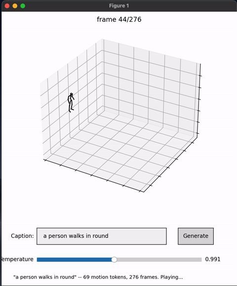

# metrina-vqvae — Text-to-Motion via VQ-VAE + GPT

**Experiment:** train a GPT-style autoregressive model that generates 3D human
motion from a text description, using a VQ-VAE to tokenize motion into a
discrete vocabulary the transformer can model like language.

This README reports the experimental setup, results, and failure modes
observed while building the pipeline. It is a results log, not a tutorial.

---

## 1. Objective

Generate plausible human motion from a natural-language prompt (e.g. *"a person
walks forward and sits down"*) by reducing motion to a sequence of discrete
tokens and learning text → token-sequence with a decoder-only transformer.

### Relationship to prior work

This project continues an earlier **Metrina AI** motion model
([Maitreana](https://github.com/BereketYibrah99/Maitreana-Make-it-real-now-Human-body-movement-processing-and-generating-model))
that used a standard **continuous VAE**.

**Problem with the previous model:** a continuous VAE encodes motion into a
*continuous* latent vector. That is **not GPT-friendly** — an autoregressive
GPT-style transformer predicts the next element as a categorical distribution
over a fixed, discrete vocabulary (softmax + cross-entropy). There is no
vocabulary in a continuous latent space to predict over, so the GPT's
next-token objective simply doesn't apply to the VAE's output. The continuous
model could represent and reconstruct motion, but it could not be driven by a
language-model-style generator.

**This version's fix:** swap the continuous VAE for a **VQ-VAE**, which encodes
motion into a *discrete* vocabulary of codebook tokens. Those tokens are exactly
the kind of categorical sequence a GPT can model — the same way it models
language tokens. In short — the prior project proved the motion representation;
this one **discretizes it to align with GPT-style generation.**

---

## 2. Method

Three independently trained stages:

### Stage A — Motion tokenizer (VQ-VAE)
Literal van den Oord et al. (2017) VQ-VAE over per-frame bone-vector features.
- 1D conv encoder/decoder with residual blocks; `code_dim = 512`,
  `num_codes = 512`.
- Hard nearest-neighbor quantization, straight-through gradient estimator,
  codebook trained by gradient descent on the codebook loss `‖sg[z_e] − e‖²`
  plus commitment loss `β‖z_e − sg[e]‖²` (no EMA).
- Training losses: reconstruction L1, velocity L1, codebook, commitment, and a
  **sparsity loss** (added to keep gradient flowing to non-winning codes — see
  §5).
- Output: a motion clip becomes a sequence of integer code indices.

### Stage B — Motion GPT
Decoder-only, GPT-2-style transformer (`n_layers = 6`, `n_heads = 8`,
`mlp_ratio = 4`, pre-LN causal self-attention + GELU MLP, learned positional
embeddings, weight-tied output head).
- Single **shared vocabulary**: text tokens + a `MOTION_START` condition token
  + `EOS` + the VQ-VAE motion codebook tokens.
- Trained autoregressively; loss is masked to motion-token positions only.
- At generation time, the prompt is encoded, `MOTION_START` is appended, and
  the model samples motion tokens (text ids are masked out of the logits so it
  can only emit motion codes), which the VQ-VAE decoder turns back into poses.

### Stage C — Root motion generator
The VQ-VAE/GPT stack reconstructs **pose** (joint rotations / bone vectors) but
is **not position-aware** — it has no notion of where the body is in world
space. Decoding pose alone produces globally glitchy motion (feet sliding,
drift). To fix this we train a separate small network that takes the current
motion state and predicts the **velocity and direction** of travel, and uses it
to drive the **hip**. The hip is chosen because it is the single consistent
axial root of the skeleton — it is least affected by the constant angular
change happening in the limbs, so it gives a stable signal to integrate into a
global trajectory. (`root_motion_net.pt`)

---

## 3. Setup

| Item | Value |
|---|---|
| Dataset | HumanML3D (text-paired motion) — trained on a **subset**, not the full dataset |
| Compute | **CPU-only** (no GPU) |
| Framework | PyTorch |
| VQ-VAE codebook | 512 codes × 512 dims |
| GPT | 6 layers, 8 heads |
| Checkpoints | `checkpoints/vqvae_bones.pt`, `checkpoints/motion_gpt.pt`, `checkpoints/root_motion_net.pt` |

Training notebooks: `notebooks/02_train_bones.ipynb` (VQ-VAE),
`notebooks/03_root_motion.ipynb` (root motion),
`notebooks/04_train_gpt.ipynb` (GPT).

> **Resource note.** This was trained entirely on **CPU** with no GPU, so
> training was run on a **subset** of HumanML3D rather than the full dataset.
> Results should be read as a proof-of-concept of the text → VQ-VAE → GPT
> pipeline under tight compute limits, not as a fully-scaled benchmark model.

---

## 4. Results

### Generated motion (text → motion)

*Generated motion from a text prompt (looping preview). Full-resolution clips:*
[`out1.mp4`](outputs/out1.mp4) · [`out2.mp4`](outputs/out2.mp4) · [`out3.mp4`](outputs/out3.mp4)

### VQ-VAE codebook ablation

Controlled 4-way ablation (200-sequence subset, 20 epochs, `lr = 1e-5`,
deterministic 64-frame chunks; usage measured as full-dataset aggregated code
usage, not a single batch):

| Configuration | Final L1 | Active codes | Perplexity |
|---|---|---|---|
| Random init + sparsity loss | 0.603 | 349/512 (68.2%) | 119.8 |
| Random init, no sparsity | 0.570 | 100/512 (19.5%) | 11.0 |
| Data-driven init, no sparsity | 0.498 | 318/512 (62.1%) | 51.8 |
| **Data-driven init + sparsity loss** | **0.512** | **511/512 (99.8%)** | **398.6** |

**Takeaway:** data-driven initialization and the sparsity loss are synergistic.
Combined, they reach 99.8% codebook utilization — far above either alone — which
is the configuration the training notebook uses.

---

## 5. Failure modes observed

Getting the VQ-VAE to train stably surfaced three distinct problems, summarized
below.

1. **Activation explosion (encoder/decoder).** Loss diverged to NaN within
   ~50–150 steps. Fixed the *fast* version by applying `GroupNorm` after
   **every** conv layer (not just before quantization), plus LR warmup and
   gradient clipping. A slower instability remained (see #3).

2. **Codebook collapse (quantizer).** Active codes crashed toward single digits
   within a few epochs while reconstruction got *worse*. Root cause in the
   literal VQ-VAE: the codebook loss only gives gradient to the argmin-winning
   code(s), so codes that lose early never learn and stay frozen at random init.
   Fixed with (a) a **sparsity loss** — a softmin-over-distances proxy of the
   assignment, temperature-calibrated to the ~512 distance scale — to push
   gradient to non-winning codes, and (b) **data-driven codebook
   initialization** (seed codes from real untrained-encoder outputs instead of
   noise).

3. **Encoder/decoder LR sensitivity.** Independent of the quantizer, L1 grew on
   the full dataset at every LR tried down to `3e-5`. The fix was a
   **data-structuring change**, not a smaller LR: switching from random 64-frame
   crops to **deterministic non-overlapping chunks** gave a consistent
   per-epoch target and produced steadily decreasing loss
   (0.83 → ~0.55–0.60 over 20 epochs).

**Methodology notes.**
- Codebook usage must be measured on the **full dataset**, not a single batch —
  single-batch snapshots are biased low (balls-into-bins: 512 assignments into
  512 codes fills only ~63% by chance even when healthy).

---

## 6. Notes / honest caveats

- When a named architecture ("VQ-VAE") is used, this repo implements the
  **literal published version**. An earlier detour into a redesigned soft
  quantizer (`CosineSoftVQ`) was abandoned — it traded codebook collapse for
  information dilution (soft blending regresses toward the codebook centroid).
- The chunk-determinism vs. data-scale confound in #3 is not fully isolated: the
  stable runs used a 200-sequence subset while the unstable runs used the full
  5408-sequence dataset. Still owed.

---

## 7. Repository contents

| Path | Contents |
|---|---|
| `notebooks/` | Training notebooks for the three stages |
| `checkpoints/` | Trained weights (VQ-VAE, GPT, root motion) |
| `outputs/` | Example generated-motion videos |
